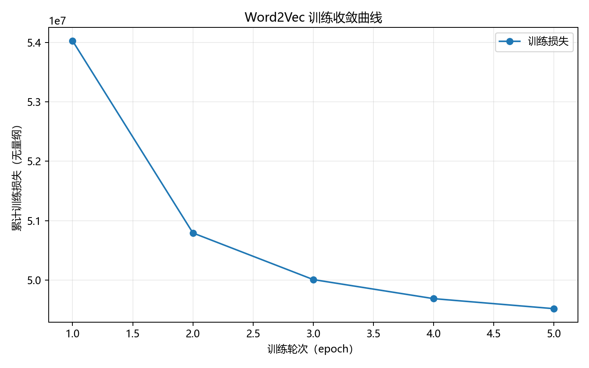
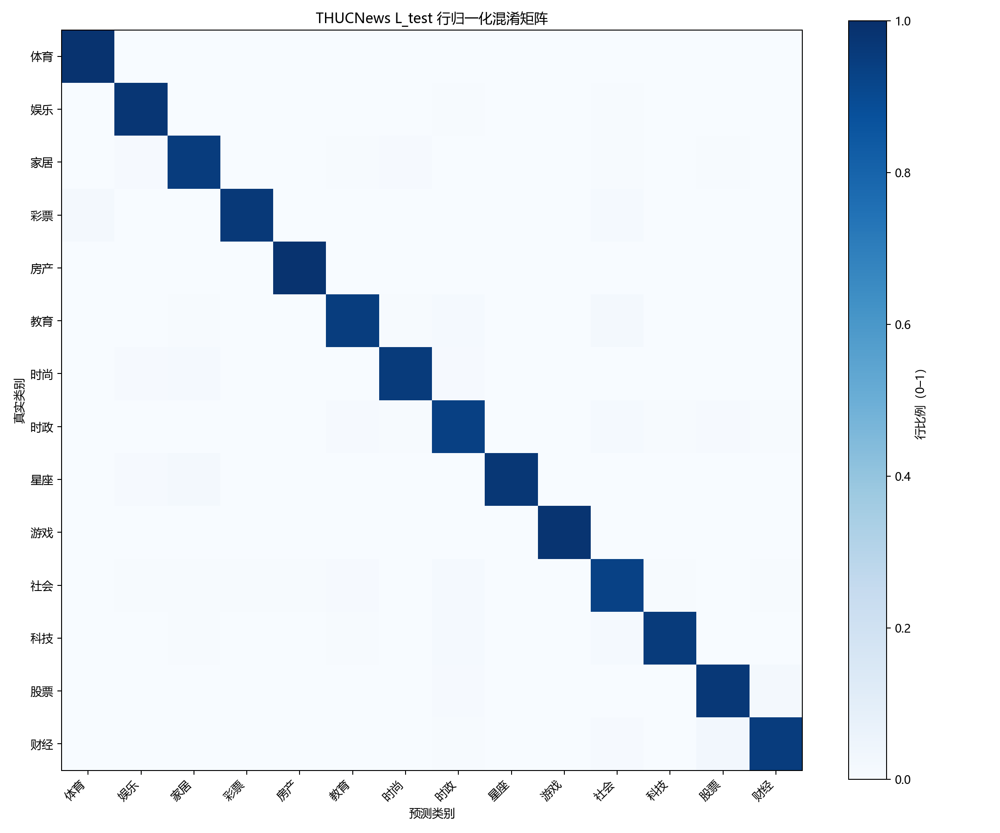
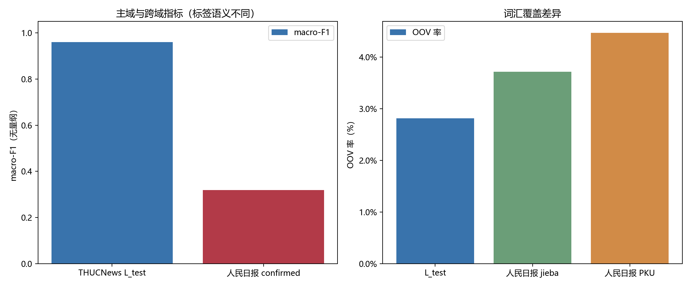
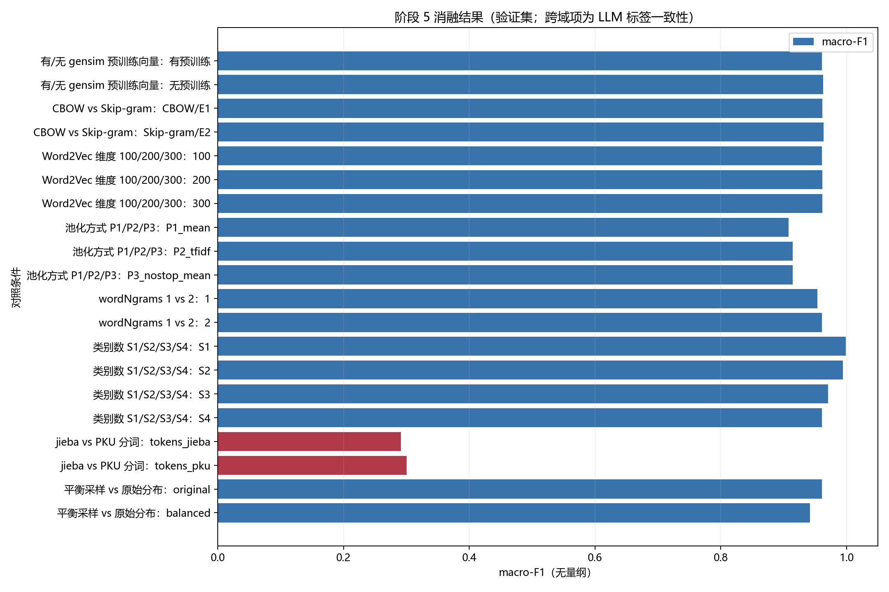

# PA2 Word2Vec 与 FastText 新闻分类实验报告

> 本报告由阶段指标、冻结模型参数与人工审查记录生成。公开数值汇总见 `result/metrics/public_summary.json`；THUCNews `L_test` 是主评估，人民日报结果只表示与 DeepSeek Flash 已确认标签的一致程度，不是人工金标准性能。

## 1. 环境

实验环境为 Python 3.9.13（64-bit），gensim 4.4.0、fasttext-wheel 0.9.2、jieba 0.42.1、numpy 1.26.4、scipy 1.11.4、scikit-learn 1.3.2、pandas 2.1.4、matplotlib 3.9.4。环境与指标见 `result/metrics/public_summary.json`；依赖锁定范围见 `requirements.txt`。固定随机种子为 `20261012`，配置单点为 `src/config.py`。

## 2. 数据与隔离

THUCNews 原始语料为 14 类共 836,075 篇；按文档划分为无标注嵌入集 U 与标注分类集 L，再由 L 划分 train/val/test。类别阶梯 S1–S4 分别为 2/4/8/14 类。人民日报 199801–199806 只作跨域测试，DeepSeek Flash 按文章正文标注，类别空间与 THUCNews 对齐；版次仅为版面元数据，不作为主题标签。

人民日报格式化文章 17,846 篇，其中 confirmed 13,734 篇（76.96%），needs_review 4,112 篇（23.04%）。模型自评置信阈值为 0.75，提示版本 `deepseek-flash-thucnews14-v2-nonthinking`。确认规则不等于人工复核或概率校准。训练/调参只使用 THUCNews train/val；人民日报不参与训练、调参或词典构建；`L_test` 仅在阶段 5 读取一次。相关汇总见 `result/metrics/public_summary.json`。
公开汇总仅保留数据隔离断言布尔值：`pd1998_in_training_assertion`=False，`training_tuning_paths_exclude_199801`=True，`L_test_opened_once_by_this_script`=True。

## 3. 方法与参数

Word2Vec 使用 gensim Skip-gram/CBOW 实验，以词上下文预测学习词向量；文档表示比较 P1 均值、P2 TF-IDF 加权均值、P3 去停用词均值。分类主线为 FastText 监督分类，另以池化向量 + LogisticRegression 作对照。先在 50k/150k/全量 U 上进行语料规模实验，再完成参数矩阵；最终 Word2Vec 选择 150,000 篇语料，得到 210,050 词词表、200 维向量。

| 参数 | 含义 | 本项目取值 | 依据/来源 |
|---|---|---|---|
| Word2Vec `vector_size` | 向量维数 | 200 | E3 维度对照与最终参数：`result/metrics/public_summary.json` |
| Word2Vec `window` | 上下文窗口 | 10 | E4 窗口实验及 `result/metrics/public_summary.json` |
| Word2Vec `min_count` | 词频下限 | 5 | 冻结参数 `result/metrics/public_summary.json` |
| Word2Vec `sg` | 0=CBOW，1=Skip-gram | 0（CBOW） | E1/E2 与 `result/metrics/public_summary.json` |
| Word2Vec `negative` / `hs` | 负采样数 / 是否层次 Softmax | 5 / 0 | E5 对照与冻结参数 |
| Word2Vec `sample` | 高频词下采样阈值 | 0.001 | 冻结参数与训练日志 |
| Word2Vec `alpha` / `min_alpha` | 初始/最低学习率 | 0.025 / 0.0001 | 冻结参数与训练日志 |
| Word2Vec `epochs` / `workers` | 训练轮数 / 工作线程 | 5 / 1 | E6 与复现约束；确定性训练使用单线程 |
| FastText `dim` | 文档特征维度 | 200 | 与预训练向量维度一致；阶段 4 验证集选择 |
| FastText `epoch` / `lr` | 训练轮数 / 学习率 | 25 / 1.0 | 覆盖式随机搜索；参数见冻结 `params.json` |
| FastText `wordNgrams` / `minCount` | 词 n-gram 阶数 / 词频下限 | 2 / 2 | A5-8 n-gram 消融及阶段 4 验证集搜索 |
| FastText `loss` | 多分类损失形式 | `ova` | 阶段 4 搜索空间与验证集结果 |
| FastText `bucket` / `thread` | 子词哈希桶 / 线程数 | 2,000,000 / 19 | 冻结模型参数；环境核数实测 |
| FastText `pretrainedVectors` / `verbose` | 初始化向量文件 / 日志级别 | gensim `best/w2v_format.vec` / 0 | 注入链路在 A0-5、A2-9 与阶段 4 输入验证通过 |
| 随机种子 | 控制采样和实验顺序 | 20261012 | `src/config.py` 与阶段指标 |
| DeepSeek 纳入阈值 | 自动确认置信门槛 | 0.75 | `result/metrics/public_summary.json`；模型自评未校准 |

公开的参数与逐组结果见 `result/metrics/public_summary.json`。完整搜索中间产物保留在本地，不纳入公开仓库。

## 4. 实验结果

### 4.1 Word2Vec

最终模型使用 CBOW、200 维、窗口 10、5 轮、U 子集 150,000 篇。词表 210,050；训练损失由 54,030,164 降至 49,515,984，相对下降 8.35%。词相似度评测覆盖 44/44 对，Spearman ρ=0.7698；类比 top-1 为 8/24（33.33%）。评测集规模有限，不能将这些指标解释为普遍语义能力。来源：`result/metrics/public_summary.json`。

### 4.2 THUCNews 主评估（轨道 A）

冻结的 `S4_best_pretrained` 在 L_test 23,488 篇上的 accuracy=0.960746、macro-F1=0.959867、weighted-F1=0.960785。混淆较多的前三类为：财经→股票（49）；教育→社会（41）；股票→财经（31）。逐类指标、混淆矩阵和 top-k 指标见 `result/metrics/public_summary.json`。结果超过计划中自设的主评估阈值，但单次固定测试集不代表所有域与未来数据。

### 4.3 人民日报跨域评估（轨道 B）

在 confirmed 子集 13,734 篇上 accuracy=0.569026、macro-F1=0.319334。指标仅表示与 DeepSeek Flash 标签的一致程度。各月数据如下：

| 月份 | confirmed 样本 | Accuracy | macro-F1 | confirmed 覆盖率 |
|---|---:|---:|---:|---:|
| 199801 | 2275 | 0.524835 | 0.290664 | 75.48% |
| 199802 | 1918 | 0.571429 | 0.278742 | 75.72% |
| 199803 | 2300 | 0.598261 | 0.281608 | 83.15% |
| 199804 | 2474 | 0.571140 | 0.331118 | 74.50% |
| 199805 | 2377 | 0.573833 | 0.358376 | 77.05% |
| 199806 | 2390 | 0.574059 | 0.300517 | 76.43% |

OOV 率：THUCNews L_test 2.81%，199801 jieba 3.97%，199801–199806 全量 3.54%。OOV 差异与标签质量、类别分布和年代语汇差异共同影响跨域结果，不能单独归因。

## 5. 消融实验

所有分类消融均使用 L_val，不读取 L_test；人民日报分词对照使用同一冻结模型，标签为 LLM confirmed。阶段 5 的全部对照如下，公开逐组汇总见 `result/metrics/public_summary.json`。

| 维度 | 条件 | 验证集/跨域 macro-F1 | 样本数 | 训练秒数 | 来源/语义 |
|---|---|---:|---:|---:|---|
| 有/无 gensim 预训练向量 | 有预训练 | 0.961100 | 23488 | 197.8 | S4_best_pretrained；L_val 验证集 |
| 有/无 gensim 预训练向量 | 无预训练 | 0.963200 | 23488 | 170.3 | S4_A5_ablations_no_pretrained_matched；L_val 验证集 |
| CBOW vs Skip-gram | CBOW/E1 | 0.961400 | 23488 | 201.6 | S4_A5_ablations_cbow_E1；L_val 验证集 |
| CBOW vs Skip-gram | Skip-gram/E2 | 0.963300 | 23488 | 205.2 | S4_A5_ablations_skipgram_E2；L_val 验证集 |
| Word2Vec 维度 100/200/300 | 100 | 0.961200 | 23488 | 141.6 | S4_A5_ablations_dimension_100；L_val 验证集 |
| Word2Vec 维度 100/200/300 | 200 | 0.961400 | 23488 | 201.6 | S4_A5_ablations_cbow_E1；L_val 验证集 |
| Word2Vec 维度 100/200/300 | 300 | 0.961600 | 23488 | 300.0 | S4_A5_ablations_dimension_300；L_val 验证集 |
| 池化方式 P1/P2/P3 | P1_mean | 0.908108 | 23488 | 39.5 | R2 LogisticRegression；L_val 验证集 |
| 池化方式 P1/P2/P3 | P2_tfidf | 0.914812 | 23488 | 36.5 | R2 LogisticRegression；L_val 验证集 |
| 池化方式 P1/P2/P3 | P3_nostop_mean | 0.914419 | 23488 | 35.9 | R2 LogisticRegression；L_val 验证集 |
| wordNgrams 1 vs 2 | 1 | 0.954000 | 23488 | 107.6 | S4_A5_ablations_wordngrams_1；L_val 验证集 |
| wordNgrams 1 vs 2 | 2 | 0.961100 | 23488 | 197.8 | S4_best_pretrained；L_val 验证集 |
| 类别数 S1/S2/S3/S4 | S1 | 0.999200 | 3965 | 19.8 | stage4_training.json；L_val 验证集 |
| 类别数 S1/S2/S3/S4 | S2 | 0.994400 | 7874 | 43.8 | stage4_training.json；L_val 验证集 |
| 类别数 S1/S2/S3/S4 | S3 | 0.970900 | 15783 | 168.1 | stage4_training.json；L_val 验证集 |
| 类别数 S1/S2/S3/S4 | S4 | 0.961100 | 23488 | 197.8 | stage4_training.json；L_val 验证集 |
| jieba vs PKU 分词 | tokens_jieba | 0.291498 | 2275 | N/A | 同一冻结 FastText 模型；与 confirmed LLM 标签对照；LLM 标签一致率，不是人工金标准准确率 |
| jieba vs PKU 分词 | tokens_pku | 0.300711 | 2275 | N/A | 同一冻结 FastText 模型；与 confirmed LLM 标签对照；LLM 标签一致率，不是人工金标准准确率 |
| 平衡采样 vs 原始分布 | original | 0.961100 | 23488 | 197.8 | S4_best_pretrained；L_val 验证集 |
| 平衡采样 vs 原始分布 | balanced | 0.942200 | 23488 | 53.1 | S4_A5_ablations_balanced_train；L_val 验证集 |

类别数增加时验证集 macro-F1 下降，反映多类任务难度及类别边界差异；预训练向量在本次验证对照未带来增益，n-gram=2 高于 n-gram=1。类别平衡采样的验证分数低于原始训练分布，这一观察仅适用于当前固定验证集，不能推导为普遍采样策略结论。分词对照的 PKU 结果 OOV 更高且 LLM 标签一致性略高，因此不应将分数差简单等同分词器质量差。

## 6. 结论

项目完成从大规模无监督词表示训练、文档池化对照到 2/4/8/14 类 FastText 监督分类的实验闭环。THUCNews 内部测试表现较高；跨域结果明显较低且与 LLM 标签分布/质量存在不确定性。现有结果支持“领域迁移需要单独评估”和“macro-F1、逐类召回比单看 accuracy 更适合类别不均衡任务”的结论，不支持将跨域指标描述为人工真值准确率，也不能从消融相关性推断因果。

## 7. 局限性

- **人民日报标签**：标签由 DeepSeek Flash 自动生成；4,112/17,846 篇需复核，confirmed 也未经逐篇人工验证。模型与标签生成模型可能共享类别偏差，标签分布不等于人工真值分布。
- **置信度**：FastText 与 DeepSeek 输出的置信度均未经概率校准，阈值只用于本项目流程规则。
- **领域漂移**：1998 年人民日报与 THUCNews 的年代、新闻风格、词汇及类别先验不同；OOV 指标不是漂移的完整度量。
- **类别不平衡**：L_train 使用分层限额而非真实自然频率，平衡采样消融显示性能会随抽样改变；结论受当前数据构造影响。
- **算力与语料规模**：Word2Vec 使用 150k 篇 U 而非全部 836k THUCNews，以满足单机实验时间约束；E7 结果与参数矩阵均需按记录的语料规模解释。
- **人工错误审查**：40 条 A5-4 样本为单人单次复核，无双人一致性或仲裁，且样本并非随机总体抽样；案例不可外推总体错误率。
- **复现范围**：`scripts/run_all.ps1` 可从已冻结指标重建报告与图表；它不重跑大语料清洗、Word2Vec/FastText 训练或 DeepSeek 标注。完整重训仍依赖原始数据、预训练模型、相应阶段脚本及 API 访问，见 `README.md`。

## 8. 小样本端到端冒烟验证

`scripts/run_all.ps1` 先从 THUCNews 原始类别目录确定性抽取小样本，独立构造 U、L_train、L_val、L_test，再训练 Word2Vec 并通过 `pretrainedVectors` 注入 FastText。实测划分为 U=56、train=84、val=14、test=14；向量词表 6,613，FastText 输入矩阵形状 `[16014, 50]`。预训练注入断言通过。烟雾测试集 macro-F1=0.0095，只用于验证链路，**不作为项目性能结果或阶段 5 指标**。轻量汇总见 `result/metrics/public_summary.json`，完整记录和样本清单保留在本地。

## 附录：来源索引

- 公开环境、模型、分类、消融及小样本指标：`result/metrics/public_summary.json`。
- 可复现脚本和配置：`scripts/`、`src/config.py`、`requirements.txt`。
- 论文阅读：`result/reports/notes_paper.md`，覆盖 5 篇论文并按 PDF 页码标注。
